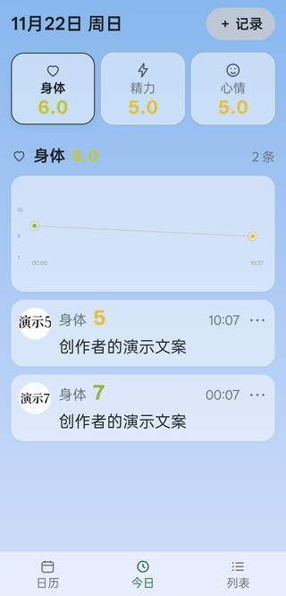
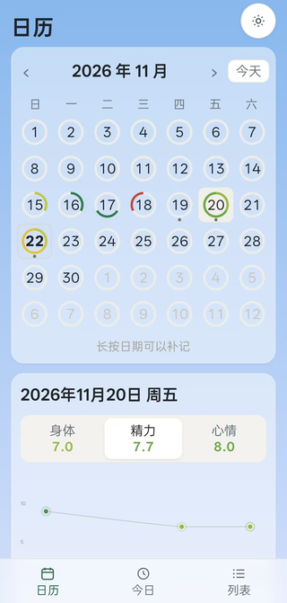
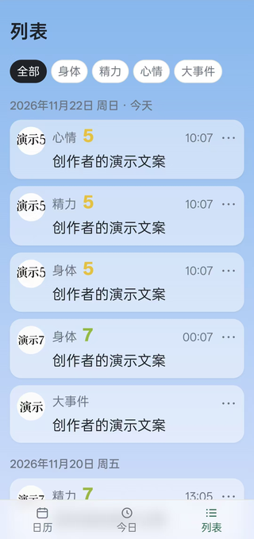

# 记录自己

一个只给自己用的生活状态记录工具：身体、精力、心情，各打 1–10 分，写一句
想说的话；一天记几次，就能看见这一天的曲线。

数据只存在自己的电脑和手机里。没有账号，没有云，没有推送，没有社交。

<p align="center">
  
  
  
</p>
<p align="center"><i>今日 · 日历 · 列表（手机端截图）</i></p>

## 为什么做

我想记的东西很少：今天身体怎么样、精力够不够、心情如何，再加一句话。

市面上的记录 App 大多往“通用”上做：习惯打卡、目标管理、社区分享、会员体系。
我只需要一个能看见“今天这一天”的小本子。

所以我决定自己做一个，需求也尽量克制：

- 一条记录只有分数和一句话，时间自动记
- 折线图最大跨度就是一天，绝不跨天
- 日历上一眼看出哪天状态好、哪天不好
- 数据只留在本机，不联网

## 怎么做的

我不是程序员，这个项目是用 AI 做的。

1. 先把自己到底要什么聊清楚，写成 `PRD.md`
2. 按阶段开发：数据层 → 今日页 → 日历 → 列表 → 设置 → 手机端
3. 每个阶段先写测试、跑通，再提交一次 Git
4. 最后用 Capacitor 打包成安卓 APK，装在自己手机上

技术上是无框架的原生 JS + Node 本地服务，手机端把存储换成 App 内的 IndexedDB。
仓库里有 `PRD.md` 和 `ACCEPTANCE.md`，以及 136 项自动化测试——它们不是装饰，
是开发过程中一条条跑过的。

## 想说的话

AI 让“给自己做一个小工具”这件事第一次变得可行：不用会写代码，不用组团队，
不用等谁先觉得这事有商业价值。

如果你也有一个“太小了、不值得做 App”的痛点，也许可以试一次。
它可能不完美，但它是按你的需求长出来的。

## 怎么用（电脑）

1. 双击 **`启动.bat`**。
2. 会弹出一个小黑窗口，同时浏览器自动打开应用。
3. 用完把小黑窗口关掉即可；数据已经保存，不会丢。
4. 下次要用，再双击 `启动.bat`。

不需要联网、不需要登录、不需要安装任何东西。

## 数据在哪

- 全部数据：`D:\jlrc\data\data.json`（记录、大事件、10 档表情图、背景与外观都在这个文件里）
- 自动备份：`D:\jlrc\data\backup\`（导入前自动生成，保留最近 10 份）

想手动备份，直接把整个 `data` 文件夹复制到别处即可；也可以在「设置 → 数据」里
点「导出记录」（只含记录与大事件，不含外观）。

## 目录结构

```
jlrc/
  启动.bat          双击启动
  server.mjs        本地服务（静态文件 + 数据读写）
  runtime/node.exe  随包附带的 Node 运行时
  app/              网页本体
    index.html
    styles.css
    js/model.mjs    数据模型（纯函数）
    js/storage.mjs  存储层（桌面走本地服务，手机走 App 内存储）
    js/chart.mjs    单日折线图
    js/ring.mjs     日历圆环
    js/view.mjs     页面渲染
    js/app.mjs      浏览器端逻辑
  android/          Capacitor 生成的安卓工程
  data/             数据文件与备份
  tests/            测试
  PRD.md            需求文档
  ACCEPTANCE.md     验收记录
```

## 手机端（Android）

安装包：`dist\jilu-ziji-1.0.0-debug.apk`（约 4.6MB，debug 签名，可直接安装）。

安装步骤：

1. 把 APK 传到手机（数据线、网盘、QQ 都行）
2. 在手机上点开安装，允许“安装未知来源应用”
3. 桌面出现「记录自己」图标，点开即用，完全离线

手机版数据存在 App 内部的 IndexedDB，和电脑版互不影响。

- 迁移已有记录：电脑「设置 → 导出记录」→ 把 JSON 传到手机 → 手机「设置 → 导入记录」
- 颜色、10 档表情图、大事件图标、背景需要在手机上重新设置（导出本来就不含外观）
- **卸载 App 会清掉手机上的数据**；覆盖安装（装新版本）不会

### 重新打包 APK

需要 JDK 21、Android SDK（platform 36 / build-tools 36）、Gradle 8.14.3。本机已装好：

- JDK：`%LOCALAPPDATA%\Programs\jlrc-tools\jdk-21.0.13.1+2`
- Gradle：`%LOCALAPPDATA%\Programs\jlrc-tools\gradle-8.14.3`
- Android SDK：`%LOCALAPPDATA%\Android\Sdk`

在项目根目录执行：

```
node node_modules\@capacitor\cli\bin\capacitor sync android
```

然后在 `android` 目录，设置好 `JAVA_HOME` 和 `ANDROID_HOME` 后执行：

```
%LOCALAPPDATA%\Programs\jlrc-tools\gradle-8.14.3\bin\gradle.bat assembleDebug
```

产物：`android\app\build\outputs\apk\debug\app-debug.apk`

## 开发与测试

在项目根目录执行：

```
runtime\node.exe --test --test-isolation=none "tests/*.test.mjs"
```

当前共 136 项测试，覆盖数据模型、页面渲染、图表几何、存储层、本地服务、
启动器与安卓工程配置。

## 边界

- 个人自用项目，不是通用产品，不追求用户量
- 无账号、无云同步、无广告；数据只在本地
- 手机端是 debug 签名，只适合自己安装，不要发到应用商店
- 代码由 AI 编写，需求、取舍和验收由作者负责
- 电脑端请固定用同一个浏览器打开；清除缓存、重装浏览器都不影响数据
- 不要删除 `data` 文件夹，那是唯一的记录
